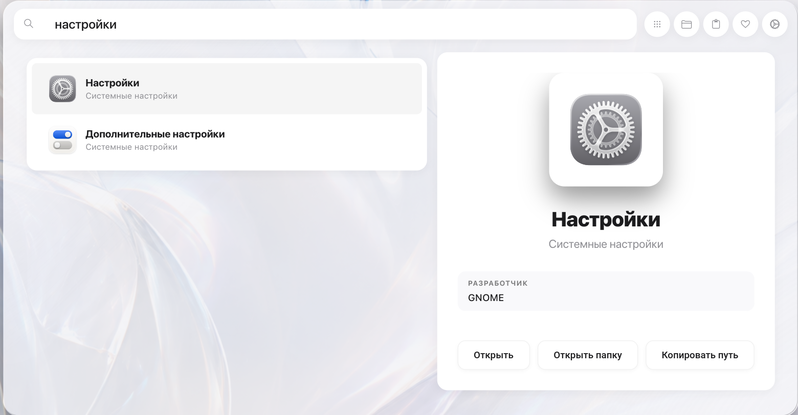
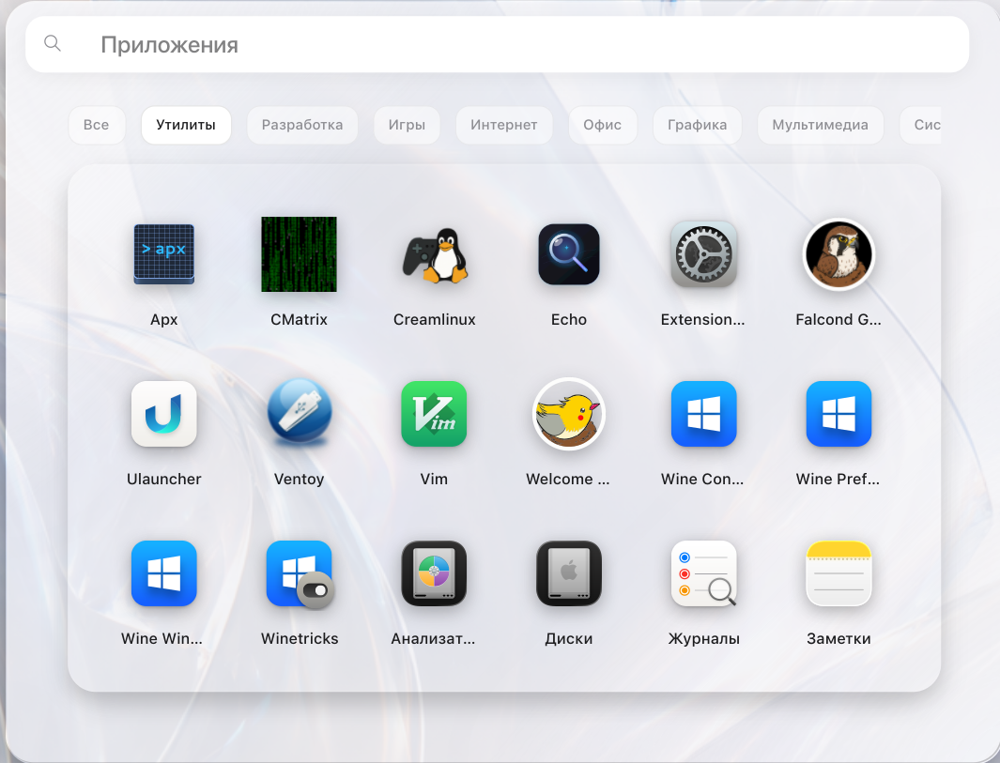
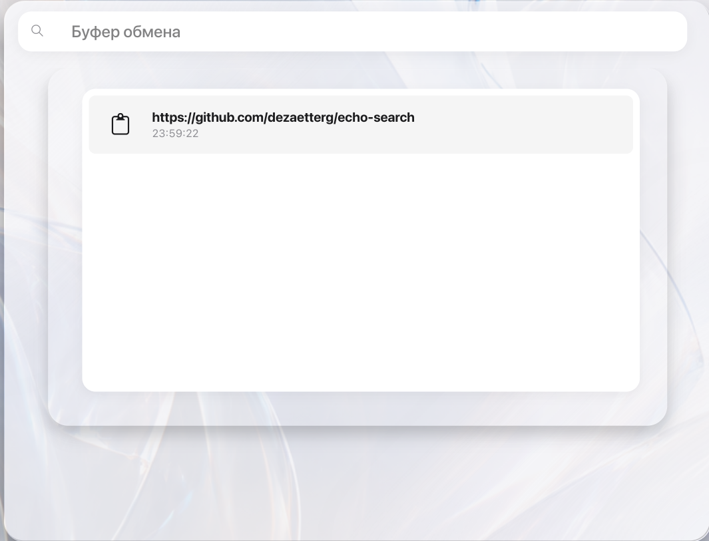
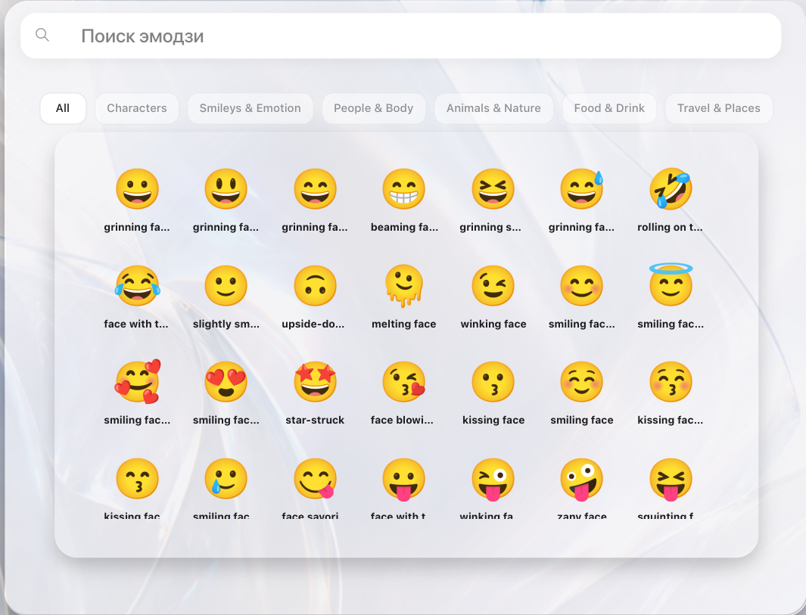
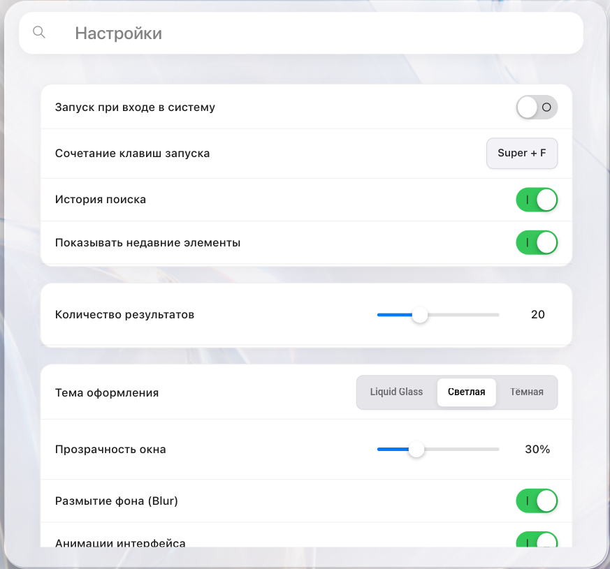

<div align="center">


# Echo Search

**Application and file launcher for Linux**

[English](#echo-search) | [Русский](#echo-search-ru)

[](https://github.com/dezaetterg/echo-search/releases)
[](LICENSE)
[](https://github.com/dezaetterg/echo-search)
[](https://www.gtk.org/)

<br>


</div>

## Features

* **Application Search**: Launch installed `.desktop` applications with fuzzy matching and keyboard layout transliteration.
* **File Search**: Search documents and media files via GNOME Tracker 3 SPARQL with category filtering (documents, images, videos, audio, archives, source code).
* **File Preview**: Preview files by pressing Space with syntax highlighting (GtkSourceView), image preview, and file metadata.
* **Clipboard History**: Store and search recent clipboard entries with preview panel (`wl-clipboard` support).
* **Calculator and Unit Converter**: Evaluate mathematical expressions and convert physical units in the input line.
* **Currency Converter**: Conversion of world currencies and cryptocurrencies (e.g., `100 usd in rub`, `50 eur in gbp`).
* **World Clock**: Local time and time zones across cities (`time tokyo`, `time in new york`).
* **Weather**: Weather summary for cities (temperature, feels like, humidity, wind, precipitation, atmospheric pressure). Background rendering of atmospheric effects with Cairo. Data from Open-Meteo API.
* **Web Search**: Queries to Google, Yandex, DuckDuckGo, YouTube, GitHub, Wikipedia, Bing, and Brave.
* **System Commands**: Lock screen, reboot, power off, suspend, and log out.
* **Emoji & Symbol Picker**: Library of symbols and emoji with categories and descriptive search.
* **Interface**: Translucent design with background blur, system theme adaptation (Portal DBus), and accent color selection.
* **Settings**: Configuration panel for themes, transparency, global hotkeys, and search providers.
* **Multi-layout Shortcut Support**: Global keybindings work on any keyboard layout (RU / EN).

## Screenshots

| Search & Preview Panel | Applications Grid & Categories |
| :-: | :-: |
|  |  |
| Clipboard History | Emoji & Symbol Picker |
| :-: | :-: |
|  |  |

<br>

<div align="center">
  <h3>Settings Panel</h3>
  
</div>

## Compatibility & Testing

* **Distributions**: Tested on **Arch Linux**, Debian-based systems (**Debian 13**, **Ubuntu**, **Linux Mint**, **PikaOS**), and **Fedora**.
* **Desktop Environments**: Tested on **KDE Plasma** and **GNOME**. Works on Wayland compositors (Hyprland, Sway, etc.).
* **Display Server**: Requires **Wayland** (`gtk4-layer-shell` protocol). **Important:** On all desktop environments under **X11**, the application does not work properly.

## Data Sources & APIs

* **Weather**: [Open-Meteo API](https://open-meteo.com/) (weather forecasts, city geocoding, hourly parameters). Free for non-commercial use.
* **Currency Rates**: ExchangeRate-API and CoinGecko feeds.

## Installation

### 1. Installation via Script (install.sh)
The script checks dependencies, installs packages, and configures **Super + Space**:

```bash
git clone https://github.com/dezaetterg/echo-search.git
cd echo-search
chmod +x install.sh
./install.sh
```

### 2. Debian / Ubuntu / Linux Mint / PikaOS (.deb)
Pre-built `.deb` package from **[Releases](https://github.com/dezaetterg/echo-search/releases)**:

```bash
# If downloaded via browser:
sudo apt install ~/Downloads/echo-search_*.deb

# Or via terminal:
wget -O /tmp/echo-search.deb https://github.com/dezaetterg/echo-search/releases/latest/download/echo-search_1.3.0_all.deb
sudo apt install /tmp/echo-search.deb
```

### 3. Arch Linux / Manjaro
Build local package using `makepkg`:

```bash
git clone https://github.com/dezaetterg/echo-search.git
cd echo-search
makepkg -si
```

### 4. Fedora / openSUSE / RHEL (.rpm)
```bash
sudo dnf install https://github.com/dezaetterg/echo-search/releases/latest/download/echo-search_latest.noarch.rpm
```

### 5. Portable Archive (.tar.gz)
Archive from **[Releases](https://github.com/dezaetterg/echo-search/releases)**:

```bash
tar -xzf echo-search_*_universal.tar.gz
cd echo-search
./install.sh
```

### 6. Run from Source
```bash
python3 main.py
```

### If Packages or Repositories are Missing (Ubuntu / Linux Mint)
If GTK4 packages or dependencies are missing, enable the `universe` repository:

```bash
sudo add-apt-repository universe
sudo apt update
```

## Controls

* `Super + Space` (or configured hotkey): open or close launcher window
* `Up / Down Arrows`: navigate results
* `Enter`: launch selected application, open file, or run action
* `Space`: file preview (documents, media, syntax-highlighted code)
* `Tab`: switch category tabs
* `Esc`: clear input line or close window

## Configuration

Settings file path:
`~/.config/echo-search/config.json`

Parameters can also be changed in the settings panel in the upper right corner of the interface (parameters button).

## Dependencies

* Python 3.10+
* GTK 4, Libadwaita, Gtk4LayerShell
* GtkSourceView 5
* Rapidfuzz
* GNOME Tracker 3 (optional, for file search)
* `wl-clipboard` (for clipboard history)

## License

GNU General Public License v3.0 (GPLv3). See [LICENSE](LICENSE).

Author: **[@dezaetterg](https://github.com/dezaetterg)**

---

<a id="echo-search-ru"></a>

<div align="center">


# Echo Search (RU)

**Лаунчер приложений и файлов для Linux**

[English](#echo-search) | [Русский](#echo-search-ru)

[](https://github.com/dezaetterg/echo-search/releases)
[](LICENSE)
[](https://github.com/dezaetterg/echo-search)
[](https://www.gtk.org/)

<br>


</div>

## Возможности

* **Поиск приложений**: запуск установленных `.desktop` программ с нечетким (fuzzy) поиском и автоматической транслитерацией ошибочной раскладки клавиатуры.
* **Поиск файлов**: поиск документов и медиафайлов через GNOME Tracker 3 SPARQL с фильтрацией по типам (документы, изображения, видео, аудио, архивы, исходный код).
* **Предпросмотр файлов**: просмотр файлов по нажатию клавиши Space с подсветкой синтаксиса исходного кода (GtkSourceView), просмотром изображений и метаданных.
* **История буфера обмена**: хранение и поиск недавних фрагментов текста с панелью предпросмотра (поддержка `wl-clipboard`).
* **Калькулятор и конвертер единиц**: вычисление математических выражений и перевод физических величин прямо в строке ввода.
* **Конвертер валют**: пересчет мировых валют и криптовалют (например, `100 usd в rub`, `50 eur in gbp`).
* **Мировое время**: текущее время и часовые пояса в городах мира (`время токио`, `time in new york`).
* **Погода**: сводка погоды для городов (температура, ощущаемая температура, влажность, ветер, осадки, атмосферное давление). Фоновый рендеринг атмосферных эффектов на Cairo. Данные из Open-Meteo API.
* **Веб-поиск**: переход к поисковым системам Google, Яндекс, DuckDuckGo, YouTube, GitHub, Wikipedia, Bing и Brave.
* **Системные команды**: блокировка экрана, перезагрузка, выключение, спящий режим и завершение сеанса.
* **Поиск символов и эмодзи**: библиотека с категоризацией и поиском по описанию.
* **Интерфейс**: полупрозрачный дизайн с размытием фона, адаптацией под системную тему (Portal DBus) и выбором акцентных цветов.
* **Настройки**: панель конфигурации тем оформления, прозрачности, глобальных хоткеев и модулей поиска.
* **Мультиязычный ввод**: глобальные сочетания клавиш работают на любых раскладках клавиатуры (RU / EN).

## Скриншоты интерфейса

| Поиск и панель предпросмотра | Сетка приложений и категории |
| :-: | :-: |
|  |  |
| История буфера обмена | Поиск эмодзи и символов |
| :-: | :-: |
|  |  |

<br>

<div align="center">
  <h3>Панель настроек</h3>
  
</div>

## Совместимость и тестирование

* **Дистрибутивы**: приложение протестировано и работает на **Arch Linux**, а также на Debian-based системах (**Debian 13**, **Ubuntu**, **Linux Mint**, **PikaOS**) и **Fedora**.
* **Окружения рабочего стола**: протестировано и работает на **KDE Plasma** и **GNOME**. Также поддерживаются современные окружения с поддержкой Wayland (Hyprland, Sway и др.).
* **Графические серверы**: требуется **Wayland** (используется протокол `gtk4-layer-shell`). **Важно:** на всех графических окружениях (DE) под управлением **X11** приложение работает некорректно.

## Источники данных и API

* **Погода и прогноз**: данные сервиса [Open-Meteo API](https://open-meteo.com/) (прогноз погоды, геокодинг городов, почасовые параметры). API доступно бесплатно для некоммерческих проектов.
* **Курсы валют**: котировки ExchangeRate-API и CoinGecko.

## Установка

### 1. Установка через скрипт (install.sh)
Скрипт проверяет пакетный менеджер, ставит системные зависимости и настраивает вызов по **Super + Space**:

```bash
git clone https://github.com/dezaetterg/echo-search.git
cd echo-search
chmod +x install.sh
./install.sh
```

### 2. Debian / Ubuntu / Linux Mint / PikaOS (.deb)
Пакет `.deb` доступен на странице **[Releases](https://github.com/dezaetterg/echo-search/releases)**:

```bash
# Если файл скачан через браузер:
sudo apt install ~/Загрузки/echo-search_*.deb || sudo apt install ~/Downloads/echo-search_*.deb

# Либо через терминал:
wget -O /tmp/echo-search.deb https://github.com/dezaetterg/echo-search/releases/latest/download/echo-search_1.3.0_all.deb
sudo apt install /tmp/echo-search.deb
```

### 3. Arch Linux / Manjaro
Сборка локального пакета через `makepkg`:

```bash
git clone https://github.com/dezaetterg/echo-search.git
cd echo-search
makepkg -si
```

### 4. Fedora / openSUSE / RHEL (.rpm)
```bash
sudo dnf install https://github.com/dezaetterg/echo-search/releases/latest/download/echo-search_latest.noarch.rpm
```

### 5. Переносимый архив (.tar.gz для любого Linux)
Архив со страницы **[Releases](https://github.com/dezaetterg/echo-search/releases)**:

```bash
tar -xzf echo-search_*_universal.tar.gz
cd echo-search
./install.sh
```

### 6. Запуск из исходного кода
```bash
python3 main.py
```

### Если пакеты или репозитории недоступны (Linux Mint / Ubuntu)

Если система сообщает, что пакеты GTK4 или зависимости не найдены, включите репозиторий `universe`:

```bash
sudo add-apt-repository universe
sudo apt update
```

## Управление

* `Super + Space` (или настроенный хоткей): открыть или скрыть окно лаунчера
* `Стрелки вверх / вниз`: навигация по результатам
* `Enter`: запуск выбранной программы, открытие файла или выполнение действия
* `Space`: предпросмотр документа, медиафайла или кода
* `Tab`: переключение между вкладками категорий
* `Esc`: очистить строку ввода или закрыть окно

## Конфигурация

Файл пользовательских настроек сохраняется по пути:
`~/.config/echo-search/config.json`

Параметры также можно изменять в панели настроек в правом верхнем углу интерфейса (кнопка параметров).

## Зависимости

* Python 3.10+
* GTK 4, Libadwaita, Gtk4LayerShell
* GtkSourceView 5
* Rapidfuzz
* GNOME Tracker 3 (опционально для глубокого поиска файлов)
* `wl-clipboard` (для буфера обмена)

## Лицензия

GNU General Public License v3.0 (GPLv3). Подробнее в файле [LICENSE](LICENSE).

Автор: **[@dezaetterg](https://github.com/dezaetterg)**
